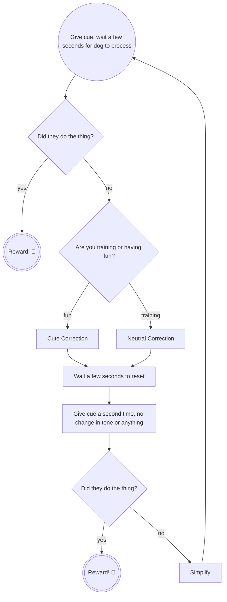

import TitleCard from "../../../components/TitleCard.astro";

<TitleCard>
## Be consistent

Use the same markers everytime. It is boring for you, but makes it clear to the dog what you are asking for.

### Keep treats on you on walks

Add random cues at random intervals on your walks. This keeps them on their toes!

## Behavior Training Flow Chart

## Breakdown

#### Give the cue

Say the cue once, then stay quiet and still for a few seconds. Dogs often need a moment to connect the word to the behavior, and repeating the cue or adding extra body language while they think just adds noise.

For early stage tricks I may start with luring with treats, and move onto physical cues, before adding a verbal cue.

#### Did they do the thing?

This one is pretty straight-forward. Did the do the behavior you requested or a different behavior.

For new tricks I may rewards attempting the behavior even if they didn't get it exactly right.

#### Reward

When I personally am training, I will ALWAYS use a marker from my short list of markers [here](/training/vocab/#markers).

That is **Yes** for one of requests and **Good** for prolonged behaviors like sit, and stay.

I do not deviate from this. Most trainers would recommend using 1 or 2 words for these markers, or using a click trainer.

You can think of **"yes!"** as the click. And (almost) always followed up immediately with a treat.

The treat reinforces the **"yes!"**. Without the treat the **"yes!"** actually means nothing.

#### Training or having fun?

Training is fun and games and can happen anytime, anywhere.  It doesn't have to be serious all the time, but
there are a couple of things to keep in mind to help get the most out of your human-to-dog communication.  

##### Markers are sacred

You can play however you want. But don't play with markers, "yes", "good", and "no" should always mean the same thing. [See cute correction](#cute-correction)

##### Don't push

If you are asking for the same cues and your dog isn't getting it. Stop. Come back to what you are asking later. [See simplify](#simplify)

#### Cute correction

A cute correction is a gentle way of letting your dog know that they are doing good and being cute, but did not in-fact do the thing you asked them to.

The key thing is to avoid using your postive markers if they didn't actually do the thing.

You can say anything you want, just don't say "yes" or "good" if they didn't do the thing. IF avoiding the word "good" feels to difficult,
you can replace the marker "good" with another word. That way you keep the *positive-continuation marker* and can say "good" as general term for
your dog being cute. Dogs are super smart, but/and they thrive on consistentency and breaking consistentency can be confusing and mentally taxing for anyone, even smart humans.

#### Neutral correction

A calm, flat "No" with no frustration in your voice. It simply means "that didn't earn a reward" so the dog can try something else.

#### Wait to reset

Pause for a few seconds before trying again. This gives the dog a clean break between attempts so the next cue feels like a fresh start.

#### Give the cue again

Repeat the cue exactly as you said it the first time: same word, same tone, same body language. If you change anything, the dog has to figure out a new cue instead of the one you're teaching.

#### Did they do the thing this time?

Same check as before. A yes earns the reward; a second miss is a sign the ask is too hard right now.

#### Simplify

Make the ask easier so the dog can succeed: get closer, lure the position, shorten the duration, or move somewhere with fewer distractions. Then start the loop over from the first cue.

</TitleCard>
