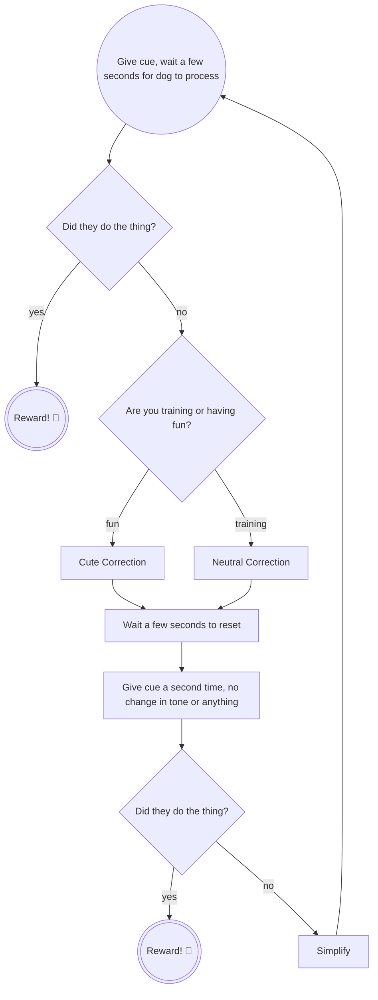

import TitleCard from "../../../components/TitleCard.astro";

<TitleCard>
## Be consistent

Use the same markers everytime. It is boring for you, but makes it clear to the dog what you are asking for.

### Keep treats on you on walks

Add random cues at random intervals on your walks. This keeps them on their toes!

## Behavior Training Flow Chart

</TitleCard>
